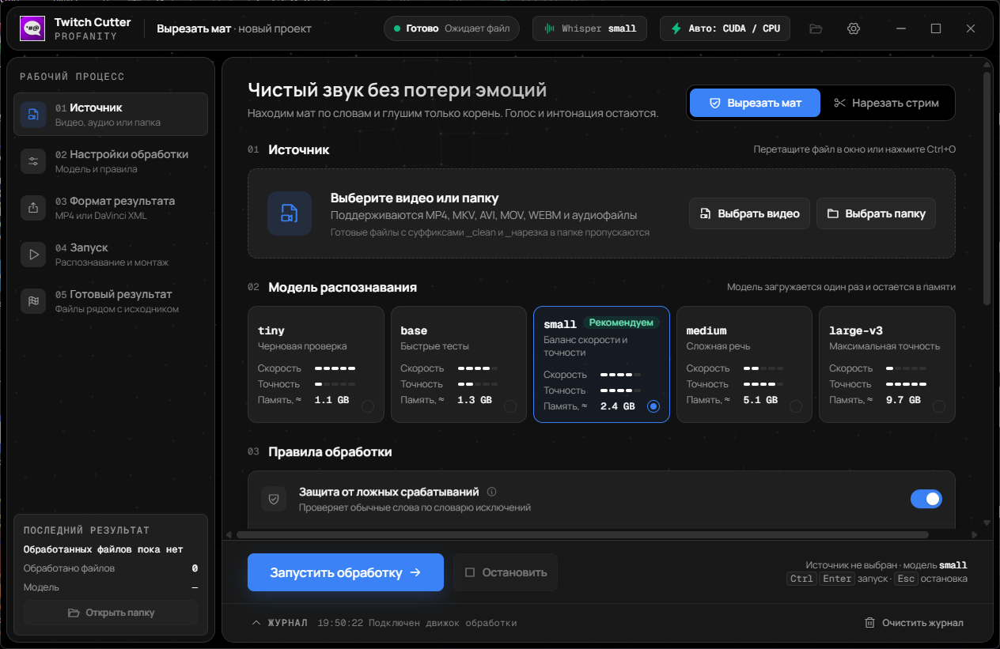

<p align="center">
  
</p>

<h1 align="center">Twitch Cutter Profanity</h1>

<p align="center">
  Локальная цензура ненормативной лексики и автоматическая нарезка стримов для Windows.(сделана полностью нейросетью для меня и для таких же людей которым лень вырезать маты)
</p>

<p align="center">
  
  
  
  
</p>

Приложение распознаёт русскую речь через `faster-whisper`, точечно глушит
мат и собирает стрим без пауз, благодарностей за донаты и чтения чата.
Обработка выполняется локально; готовый результат экспортируется в MP4 или
DaVinci Resolve XML.



## Возможности

- Точечное глушение найденных слов без удаления голоса и интонации вокруг них.
- Пользовательские стоп-слова, словарь исключений и мягкое глушение окончаний.
- Удаление пауз, донатов и чтения чата независимыми переключателями.
- Пакетная обработка файлов в папке.
- Экспорт MP4 и таймлайна DaVinci Resolve XML.
- Модели Whisper `tiny`, `base`, `small`, `medium` и `large-v3`.
- CUDA `float16` на совместимой NVIDIA GPU и автоматический fallback на CPU `int8`.
- Встроенные FFmpeg, ffprobe и CUDA runtime в Windows-релизе.

## Скачать готовое приложение

1. Откройте страницу [GitHub Releases](../../releases).
2. Скачайте `Twitch-Cutter-Profanity-v0.1.0-windows-x64-nvidia.zip` и файл
   с таким же именем и расширением `.sha256`.
3. Распакуйте архив в любую папку. Не перемещайте EXE отдельно от `_internal`.
4. Запустите `Twitch Cutter Profanity.exe`.

Публикуемая сборка не подписана коммерческим сертификатом. При первом запуске
Windows SmartScreen может показать предупреждение. Сверьте SHA-256 архива с
опубликованной контрольной суммой перед запуском:

```powershell
(Get-FileHash ".\Twitch-Cutter-Profanity-v0.1.0-windows-x64-nvidia.zip" -Algorithm SHA256).Hash
Get-Content ".\Twitch-Cutter-Profanity-v0.1.0-windows-x64-nvidia.zip.sha256"
```

### Системные требования

- Windows 10 или 11 x64.
- Microsoft Edge WebView2 Runtime.
- Для ускорения: совместимая NVIDIA GPU и актуальный драйвер. Без NVIDIA
  приложение автоматически использует CPU.
- Свободное место для приложения и моделей Whisper. Модель скачивается с
  Hugging Face при первом выборе и затем используется из локального кэша.

## Использование

1. Выберите **«Вырезать мат»** или **«Нарезать стрим»**.
2. Добавьте видео, аудиофайл или папку.
3. Выберите модель распознавания и правила обработки.
4. Укажите форматы и папку результата.
5. Нажмите **«Запустить обработку»**.

Поддерживаются MP4, MKV, AVI, MOV, WEBM, FLV, WMV, M4V, MP3, WAV, M4A,
AAC, FLAC, OGG, OPUS и WMA. Горячие клавиши: `Ctrl+O` — выбрать файл,
`Ctrl+Enter` — запустить, `Esc` — остановить.

| Режим | Результат |
| --- | --- |
| Цензура | `<имя>_clean.<расширение>` и `<имя>_отчет_цензуры.txt` |
| Нарезка | `<имя>_нарезка.mp4`, `<имя>_нарезка_DaVinci.xml`, `<имя>_отчет_нарезки.txt` |

При цензуре видеопоток копируется без повторного кодирования, а аудио
перекодируется с глушением найденных интервалов. Если совпадений нет,
создаётся только отчёт. Для импорта XML в DaVinci Resolve используйте
**File → Import Timeline**.

## Конфиденциальность

Видео и результаты не отправляются на сервер проекта. Сетевое соединение
используется для первоначальной загрузки выбранной модели с Hugging Face.
Телеметрия в приложении отсутствует.

## Запуск из исходников

Требуются Python 3.10 x64, FFmpeg и ffprobe в `PATH`.

```powershell
python -m venv .venv
.\.venv\Scripts\Activate.ps1
python -m pip install --upgrade pip
python -m pip install -r requirements.txt
python web_app.py
```

Команды выполняются из корня локальной копии репозитория.

Для CUDA установите дополнительные зависимости:

```powershell
python -m pip install -r requirements-gpu.txt
```

Кэш моделей по умолчанию находится в
`%USERPROFILE%\.cache\huggingface\hub`. Путь можно изменить переменными
`HF_HOME` или `HF_HUB_CACHE`.

## Тесты

```powershell
python -X utf8 -m unittest discover -s tests -v
python tools/check_release.py --source-only
node --check design/app.js
```

Интеграционные тесты создают короткие синтетические медиа и проверяют
цензуру, нарезку, отмену, сохранение видеопотока, синхронизацию и DaVinci XML.

## Сборка Windows-релиза

Сборка выполняется на Windows с FFmpeg и ffprobe в `PATH`:

```powershell
python -m pip install -r requirements-build.txt
python tools/build_release.py --self-test
```

Команда создаёт NVIDIA-сборку, ZIP-архив и SHA-256 в папке `release`.
Скрипт проверяет метаданные версии, обязательные лицензии, отсутствие
непереносимых ярлыков и лимит GitHub Release в 2 ГиБ на один файл.

Workflow `.github/workflows/release.yml` запускает те же проверки. Тег версии
должен совпадать с `app_meta.py`:

```powershell
git tag v0.1.0
git push origin main --tags
```

После отправки тега GitHub Actions создаёт **черновик** релиза. Проверьте
архив и заметки, затем опубликуйте релиз вручную.

## Структура проекта

```text
design/                 HTML, CSS, JavaScript и локальные шрифты
tests/                  модульные и интеграционные тесты
tools/                  проверка и упаковка релиза
web_app.py              окно приложения и Python ↔ JavaScript bridge
censor_engine.py        цензура аудио
stream_cutter.py        анализ и нарезка стримов
speech_engine.py        Whisper, VAD, CUDA и CPU fallback
Twitch Cutter Profanity.spec
```

## Участие и безопасность

- Правила разработки: [CONTRIBUTING.md](CONTRIBUTING.md)
- Сообщение об уязвимости: [SECURITY.md](SECURITY.md)
- История изменений: [CHANGELOG.md](CHANGELOG.md)
- Чек-лист публикации: [RELEASE_CHECKLIST.md](RELEASE_CHECKLIST.md)

## Лицензия

Исходный код распространяется по лицензии [MIT](LICENSE). FFmpeg, NVIDIA
runtime, библиотеки, шрифты и иконки имеют собственные условия. Подробности:
[THIRD_PARTY_NOTICES.md](THIRD_PARTY_NOTICES.md).
